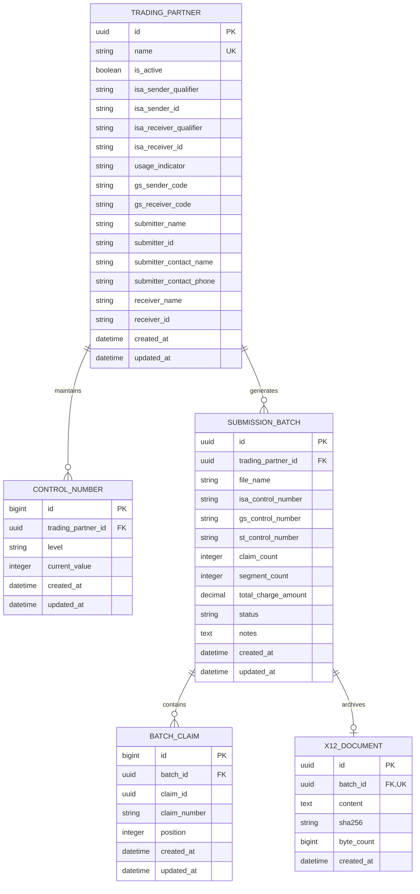

`X12Document` maps to `edi_x12document`. It stores the entire generated file as
one string, including its final newline, with a SHA-256 checksum and UTF-8 byte
count. One archived file can contain multiple claims; `BatchClaim` records the
claim membership and wire order.

The document is optional in this diagram because batches created before the
archive migration remain unchanged. Every successful non-dry-run export through
the updated command creates one document. The one-to-one constraint prevents
duplicate archive rows for a batch, and its `PROTECT` relationship blocks ordinary
ORM deletion of an archived batch. No automatic expiry or historical backfill is
implemented. See [archive behavior and review](../x12-archive.md).
