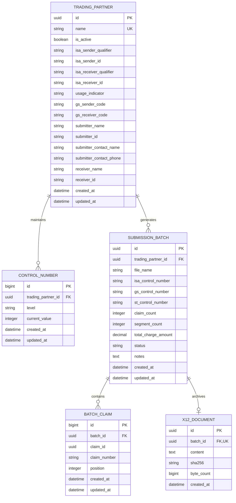
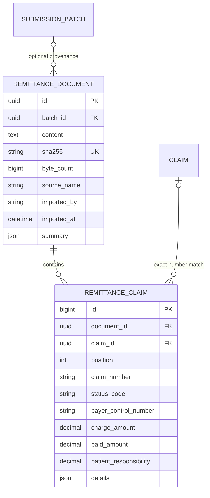

# EDI export and response records

## Generated files

`X12Document` maps to `edi_x12document`. It stores the entire generated file as
one string, including its final newline, with a SHA-256 checksum and UTF-8 byte
count. One archived file can contain multiple claims; `BatchClaim` records the
claim membership and wire order.

The document is optional in this diagram because batches created before the
archive migration remain unchanged. Every successful non-dry-run export through
the updated command creates one document. The one-to-one constraint prevents
duplicate archive rows for a batch, and its `PROTECT` relationship blocks ordinary
ORM deletion of an archived batch. No automatic expiry or historical backfill is
implemented. See [archive behavior and review](../x12-archive.md).

## Returned 835 files

`RemittanceDocument` retains the exact imported ASCII 835 text and integrity metadata. A duplicate SHA-256 reuses the existing receipt rather than creating duplicate claim results. `RemittanceClaim` stores each CLP result in file order. Its optional claim link uses an exact claim-number match; an unmatched number remains visible for review. The original CLP number remains even if a linked claim is later removed.

The bounded viewer retains service-level SVC/CAS data and financial values in `details`; it does not guess service-line identity from procedure codes or positions. An operator may supply a submission-batch UUID as provenance only when the importer verifies the claim membership. The 835 and the original 837P have separate immutable document records; importing a response never rewrites the submitted X12 or marks a batch paid/accepted.

Application-level read-only controls do not make these tables tamper-proof against direct SQL. Staff login is required for import, viewing, and download. See [server workflow](../server-workflow.md) for retrieval and review.
